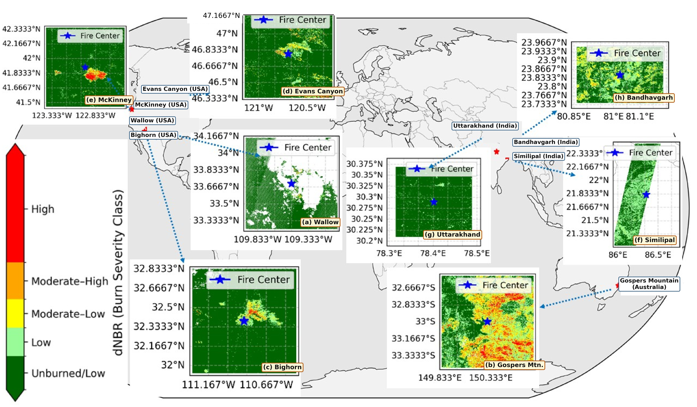
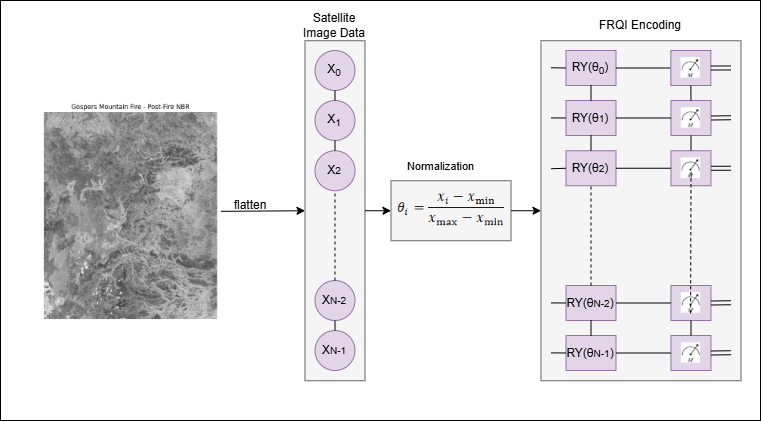
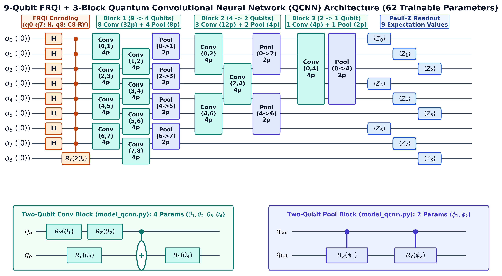
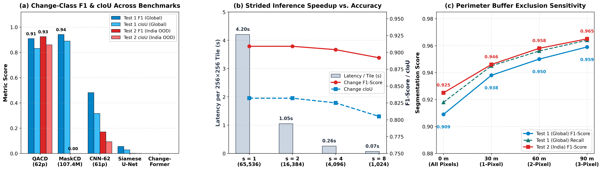
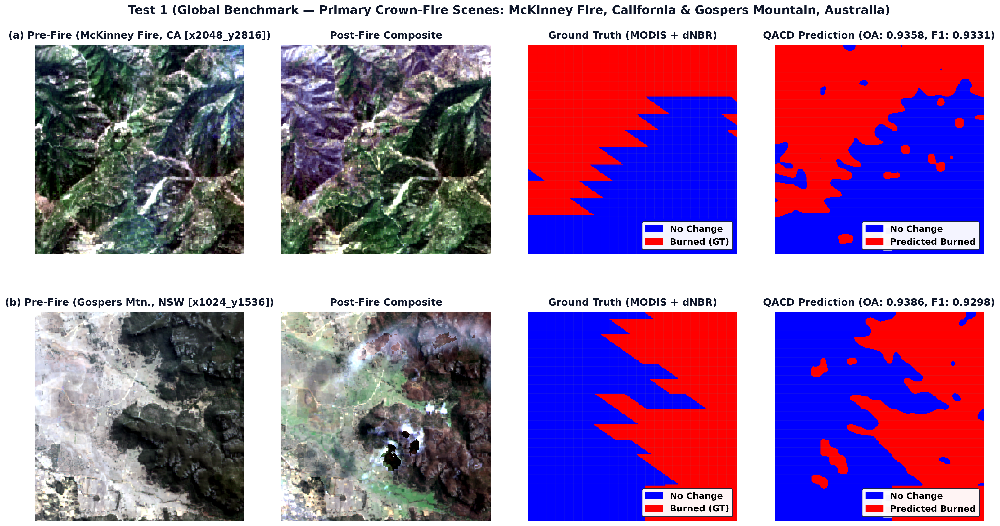
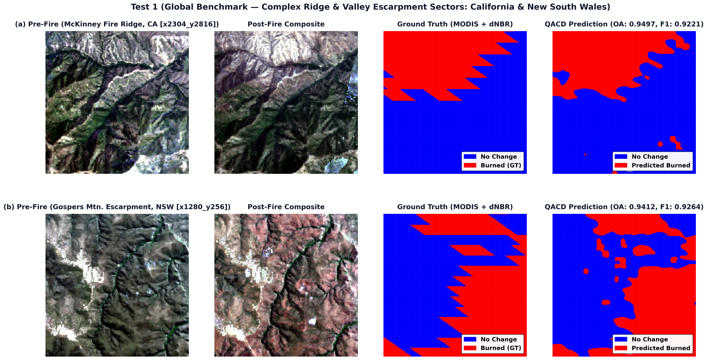
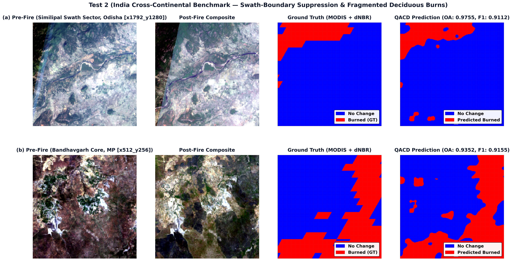
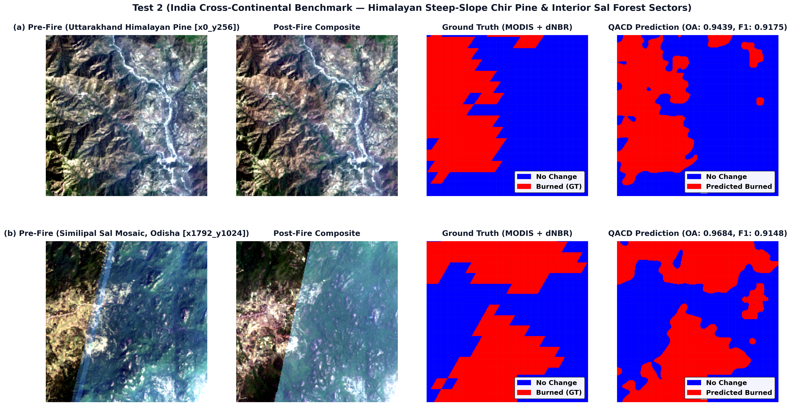

# Quantum Automatic Change Detection (QACD) for Wildfire Burned Area Mapping

[](LICENSE)
[](https://www.python.org/)
[](https://qiskit.org/)
[](https://pytorch.org/)

Official implementation of the **Quantum Automatic Change Detection (QACD)** framework for multi-continental wildfire burned-area segmentation from bi-temporal Landsat-8 Operational Land Imager (OLI) satellite imagery ($30\text{ m}$ spatial resolution).

QACD encodes localized $11 \times 11$ pre-fire and post-fire spectral patches into a **9-qubit Hilbert space** ($\mathcal{H} = (\mathbb{C}^2)^{\otimes 9}$, $512$ basis dimensions) using the **Flexible Representation of Quantum Images (FRQI)** and extracts multi-scale bi-temporal change features through a **three-stage hierarchical Quantum Convolutional Neural Network (QCNN)** containing only **62 trainable quantum gate parameters**, coupled with a lightweight spatial refinement head ($17.55\text{ K}$ total hybrid parameters, $69.23\text{ K MACs}$) and orbital swath-edge validity masking.

---

## Key Highlights

- **Exponential Spatial Compression via 9-Qubit FRQI:** Compresses concatenated $11 \times 11$ pre-fire ($121$ pixels) and post-fire ($121$ pixels) windows ($242$ elements padded with $14$ zeros to $256 = 2^8$) into $8$ spatial position qubits ($q_0\text{--}q_7$) and $1$ color qubit ($q_8$). Because $\cos^2(\theta_k) + \sin^2(\theta_k) = 1$ holds identically across all $256$ basis states, FRQI enforces exact patch-local Bloch-sphere normalization that stabilizes representations against cross-biome canopy-albedo and solar-irradiance shifts.
- **Ultra-Compact 62-Parameter Hierarchical QCNN Core:** Alternating stages of staggered two-qubit variational convolutions ($4$ parameters per pair) and controlled quantum pooling ($2$ parameters per pair: $CR_Z, CR_Y$) reduce the active register across $9 \rightarrow 4 \rightarrow 2 \rightarrow 1$ qubits ($32 + 8 + 12 + 4 + 4 + 2 = 62$ trainable quantum parameters across $19$ two-qubit pairs / $31$ two-qubit gates) with logarithmic circuit depth $\mathcal{O}(\log n)$, avoiding barren plateaus during parameter-shift optimization.
- **Zero-Shot Cross-Biome Resilience:** Evaluated across **9 major wildfire events** spanning **North America, Australia, and India**, QACD achieves $F_1 = 0.909$ ($\mathrm{cIoU} = 0.832$) on the in-distribution global crown-fire benchmark (**Test 1**) and **$F_1 = 0.925$ ($\mathrm{cIoU} = 0.860$)** under zero-shot transfer to fragmented Indian deciduous surface burns (**Test 2**, $26.32:1$ No-Change-to-Change pixel skew), preventing the minority-class recall collapse suffered by large-scale classical baselines while reducing parameter count by $6,120\times$ relative to MaskCD ($107.41\text{ M}$ parameters).

---

## Multi-Continental Study Areas & Dataset Splits



The benchmark spans nine wildfire events across distinct forest biomes, topographic gradients, and climatic regimes on three continents using cloud-screened Landsat-8 Collection 2 Level-2 surface reflectance composites ($30\text{ m}$ resolution, $256 \times 256$ tiles) cross-checked with MODIS Burned Area (`MCD64A1`) thermal anomalies ($\mathrm{dNBR} \ge 0.27$):

| Fire Event | Location | Biome / Forest Regime | Lon, Lat | Pre-Fire Window | Post-Fire Window | Split Role |
| :--- | :--- | :--- | :---: | :---: | :---: | :---: |
| **Wallow Fire** | Arizona, USA | Montane Conifer | $-109.500^\circ, 33.700^\circ$ | 2011-05-01 – 2011-05-28 | 2011-06-25 – 2011-07-20 | Train ($265$ patches) |
| **Evans Canyon Fire** | Washington, USA | Shrub-Steppe / Mixed Pine | $-120.695^\circ, 46.793^\circ$ | 2020-07-01 – 2020-08-30 | 2020-09-20 – 2020-10-10 | Train |
| **August Complex Fire** | California, USA | Mediterranean Mixed Conifer | $-121.349^\circ, 37.362^\circ$ | 2020-07-01 – 2020-07-15 | 2020-08-25 – 2020-09-12 | Train |
| **Bighorn Fire** | Arizona, USA | Semi-Arid Sky Island Pine | $-110.857^\circ, 32.383^\circ$ | 2020-05-01 – 2020-06-04 | 2020-07-24 – 2020-08-15 | Validation ($41$ patches) |
| **Gospers Mountain Fire** | NSW, Australia | Temperate *Eucalyptus* | $150.300^\circ, -33.000^\circ$ | 2019-09-01 – 2019-10-25 | 2020-01-20 – 2020-02-25 | **Test 1: Global** ($219$ patches) |
| **McKinney Fire** | California, USA | Klamath Mixed Conifer | $-122.950^\circ, 41.900^\circ$ | 2022-07-01 – 2022-07-28 | 2022-08-18 – 2022-09-10 | **Test 1: Global** |
| **Uttarakhand Fire** | Uttarakhand, India | Himalayan Subtropical Chir Pine | $78.402^\circ, 30.289^\circ$ | 2022-04-01 – 2022-04-17 | 2022-04-18 – 2022-04-25 | **Test 2: India OOD** ($255$ patches) |
| **Similipal Fire** | Odisha, India | Tropical Moist Deciduous (*Shorea robusta*) | $86.355^\circ, 21.824^\circ$ | 2022-02-15 – 2022-02-22 | 2022-05-17 – 2022-05-25 | **Test 2: India OOD** |
| **Bandhavgarh Fire** | Madhya Pradesh, India | Tropical Dry Deciduous (Teak/Sal/Bamboo) | $81.024^\circ, 23.846^\circ$ | 2022-03-14 – 2022-03-21 | 2022-04-01 – 2022-04-17 | **Test 2: India OOD** |

---

## Methodology & Quantum Circuit Architecture

### 1. FRQI Quantum State Preparation ($9$ Qubits)



For each pixel center $(r, c)$, localized $11 \times 11$ pre-fire and post-fire luminance patches ($121$ pixels each) are concatenated into a 242-element bi-temporal vector, scaled to $[0, 1]$, and zero-padded with $14$ trailing zeros to $N = 2^8 = 256$ elements $\mathbf{v} = (v_0, \dots, v_{255})^\top$. Applying Hadamard gates $H^{\otimes 8}$ on the position register $q_0\text{--}q_7$ and multi-controlled rotations $C^8_{|k\rangle_p} R_Y(2\theta_k)$ with $\theta_k = \frac{\pi}{2}v_k$ on color qubit $q_8$ prepares the entangled 9-qubit FRQI state:

$$|I(\mathbf{v})\rangle = \frac{1}{16}\sum_{k=0}^{255}\left[\cos(\theta_k)|0\rangle_c + \sin(\theta_k)|1\rangle_c\right] \otimes |k\rangle_p$$

### 2. Three-Stage Hierarchical QCNN Classifier ($62$ Trainable Parameters)



| QCNN Stage | Active Qubits | Two-Qubit Pairs & Primitives | Params / Pair | Trainable Params |
| :--- | :---: | :--- | :---: | :---: |
| **FRQI Encoding** | $9$ ($q_0\text{--}q_8$) | $H^{\otimes 8}$ on $q_0\text{--}q_7$, $256 \times C^8 R_Y(2\theta_k)$ on $q_8$ | $0$ | $0$ |
| **Conv Block 1** | $9$ ($q_0\text{--}q_8$) | $4\text{ even} + 4\text{ odd} = 8\text{ pairs}$ ($R_Y, R_Z, \mathrm{CX}, R_Y$) | $4$ | $32$ |
| **Pool Block 1** | $9 \rightarrow 4$ | $4\text{ pairs}$ ($q_{0..3} \to q_{4..7}$: $CR_Z, CR_Y$) | $2$ | $8$ |
| **Conv Block 2** | $4$ ($[q_0,q_2,q_4,q_6]$) | $2\text{ even} + 1\text{ odd} = 3\text{ pairs}$ | $4$ | $12$ |
| **Pool Block 2** | $4 \rightarrow 2$ | $2\text{ pairs}$ ($q'_{0..1} \to q'_{2..3}$: $CR_Z, CR_Y$) | $2$ | $4$ |
| **Conv Block 3** | $2$ ($[q_0,q_4]$) | $1\text{ even pair}$ $(0, 4)$ | $4$ | $4$ |
| **Pool Block 3** | $2 \rightarrow 1$ ($[q_4]$) | $1\text{ pair}$ $(0 \to 4)$ | $2$ | $2$ |
| **Total QCNN Core** | **9 Qubits** | **19 Two-Qubit Pairs (31 Two-Qubit Gates)** | --- | **62** |

---

## Quantitative Benchmark Results

### Overall & Change-Class Performance (Test 1 Global vs. Test 2 India Zero-Shot)

| Model | Paradigm | Core / Total Params | Operations | Test 1 OA | Test 1 F1 | Test 1 cIoU (mIoU) | Test 2 OA | Test 2 F1 | Test 2 cIoU (mIoU) |
| :--- | :--- | :---: | :---: | :---: | :---: | :---: | :---: | :---: | :---: |
| **QACD (Proposed)** | **FRQI + 9Q-QCNN** | **62 / 17.55 K** | **69.23 K MACs** | 0.910 | 0.909 | 0.832 (0.828) | 0.920 | **0.925** | **0.860 (0.875)** |
| MaskCD | Swin + MA-DETR | 107.41 M | 64.09 GFLOPs | **0.930** | **0.942** | **0.890 (0.875)** | 0.950 | 0.000 | 0.000 (0.475) |
| Classical-CNN-62 | Parameter-Matched CNN | 61 | 41.20 K MACs | 0.840 | 0.482 | 0.317 (0.548) | 0.890 | 0.171 | 0.093 (0.481) |
| Siamese U-Net | Siamese ConvNet | 1.22 M | 4.82 GFLOPs | 0.820 | 0.056 | 0.029 (0.367) | 0.950 | 0.002 | 0.001 (0.480) |
| ChangeFormer | Hierarchical MiT | 3.66 M | 11.38 GFLOPs | 0.730 | 0.0004 | 0.0002 (0.360) | **0.960** | 0.000 | 0.000 (0.480) |



### Qualitative Segmentation Results

#### Test 1 (Global In-Distribution: McKinney Fire, California & Gospers Mountain, Australia)



#### Test 2 (India Zero-Shot Transfer: Similipal, Bandhavgarh & Uttarakhand Fires)



---

## Repository Structure

```text
.
├── qcnn_change_detection.py          # Standalone Qiskit FRQI-QCNN pipeline (patch training & GeoTIFF map export)
├── model_qcnn.py                     # 9-qubit FRQI + 3-stage QCNN architecture (62 trainable quantum parameters)
├── model_qacd.py                     # Hybrid QACD model (FRQI-QCNN core + spatial refinement head)
├── model_siamese_unet.py             # Fully Convolutional Siamese U-Net baseline (1.22M params)
├── model_changeformer.py             # ChangeFormer MiT Siamese transformer baseline (3.66M params)
├── model_bit.py                      # Bi-Temporal Image Transformer (BIT) baseline
├── model_a2net.py                    # A2Net lightweight attention baseline
├── model_classical_dnbr.py           # Classical dNBR threshold & Classical-CNN-62 control (61 params)
├── dataset_cd.py                     # Multi-continental Landsat-8 OLI dataset loader & swath validity mask
├── ieee_reproducible_benchmark.py    # End-to-end reproducible evaluation, stride ablation & buffer analysis
├── train_and_evaluate_all_rgb.py     # Unified training & evaluation runner across Global & India splits
├── train_evaluate_models.py          # Model training utility script
├── run_rgb_evaluation.py             # Per-tile & dataset-wide metric evaluation script
├── generate_publication_plots.py     # Publication figure generator
├── regenerate_all_figures.py         # High-DPI multi-panel figure & circuit diagram generator
├── qacd_rgb.pth                      # Pretrained QACD hybrid checkpoint
├── requirements.txt                  # Python package dependencies
└── docs/                             # Architecture diagrams, study area maps & qualitative prediction panels
    ├── method_overview.png
    ├── QCNN_architecture.png
    ├── study_areas_map.jpg
    ├── fig_test1_global_predictions.png
    ├── fig_test1_secondary_predictions.png
    ├── fig_test2_india_predictions.png
    ├── fig_test2_india_secondary_predictions.png
    └── fig_quantitative_ablation_analysis.png
```

---

## Installation & Usage

### 1. Install Dependencies

```bash
pip install -r requirements.txt
```

### 2. Run the Reproducible Multi-Continental Benchmark

To evaluate the pretrained QACD model and classical baselines across **Test 1 (Global)** and **Test 2 (India Zero-Shot)**, including the inference stride ablation ($s \in \{1, 2, 4, 8\}$) and perimeter mixed-pixel buffer analysis ($0\text{ m}$ to $90\text{ m}$):

```bash
python ieee_reproducible_benchmark.py
```

### 3. Run the Standalone Qiskit FRQI-QCNN Pipeline

```bash
python qcnn_change_detection.py
```

### 4. Regenerate All Publication Figures & Circuit Diagrams

```bash
python regenerate_all_figures.py
```

---

## Authors & Acknowledgments

- **M. S. Shyam Sunder** — Department of Earth and Atmospheric Sciences, National Institute of Technology Rourkela, Odisha, India
- **Çağın Bera Bay** — FMV Işık Erenköy Science High School, Istanbul, Türkiye
- **Yasemin Poyraz Koçak** — Department of Computer Technologies, Istanbul University-Cerrahpaşa, Istanbul, Türkiye
- **Bhishma Tyagi** (*Corresponding Author*) — Department of Earth and Atmospheric Sciences, National Institute of Technology Rourkela, Odisha, India (`tyagib@nitrkl.ac.in`)

---

## License

This project is licensed under the [MIT License](LICENSE).
