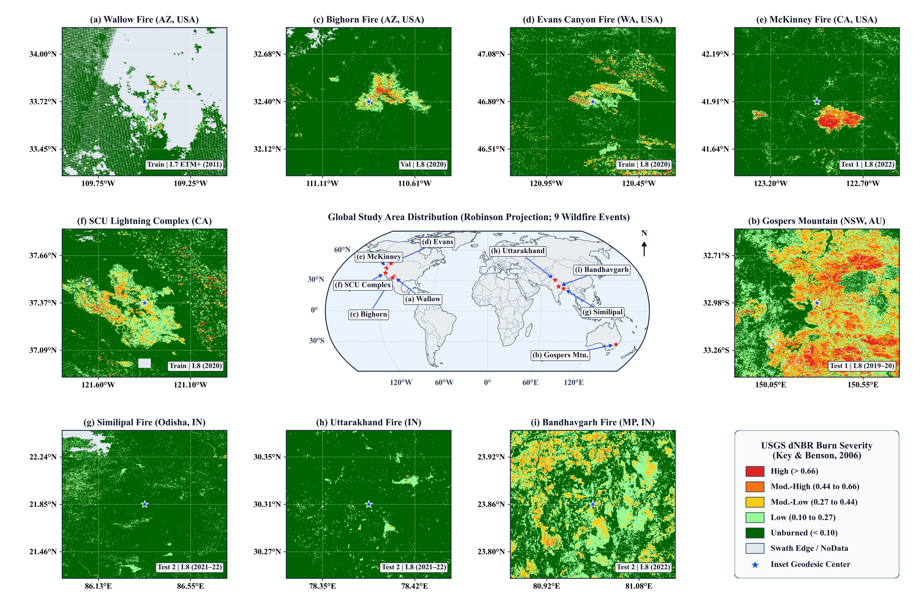
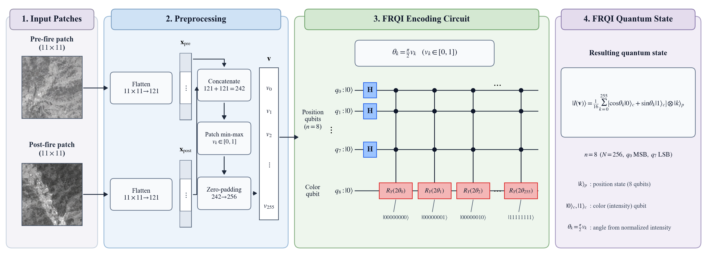
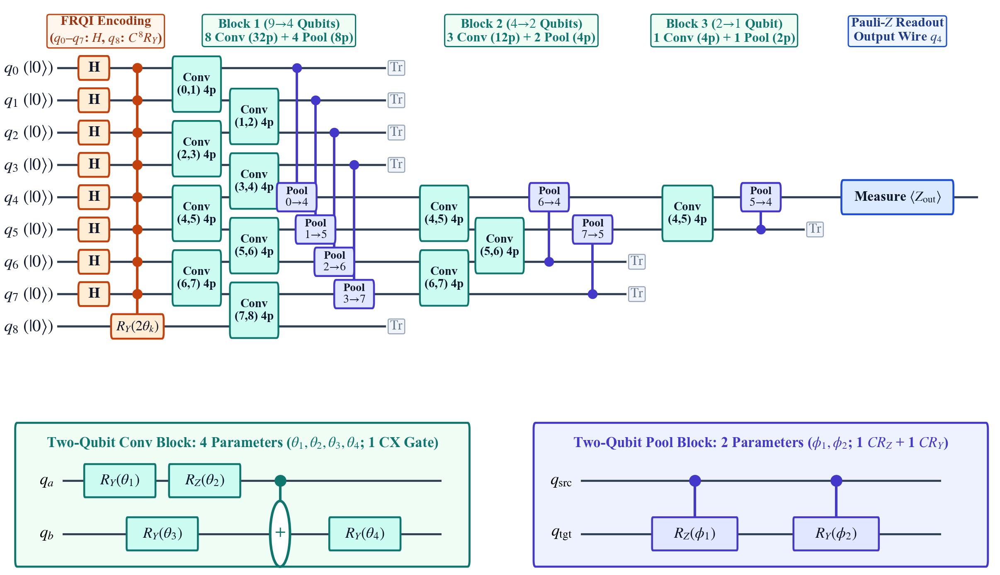

# Quantum Automatic Change Detection (QACD) Model for Wildfire Burned Area Mapping

[](LICENSE)
[](https://www.python.org/)
[](https://pytorch.org/)
[](https://www.ibm.com/quantum/qiskit)

Official source code for the proposed hybrid **Quantum Automatic Change Detection (QACD)** model for wildfire burned-area mapping from multi-sensor **Landsat-7 ETM+** (2011) and **Landsat-8 OLI** (2019–2022) Collection 2 Level-2 surface reflectance imagery across nine fire events in North America, Australia, and India (1,486 bi-temporal $256 \times 256$ tile pairs at 30 m pixel scale in Web Mercator `EPSG:3857`).

> **Scope:** This repository contains strictly the zero-leakage implementation of the proposed **QACD** architecture (9-qubit FRQI state preparation, 62-parameter three-stage QCNN core, 17,488-parameter classical spatial refinement head, controlled internal ablations, pretrained checkpoints, and Qiskit circuit/noise verification). Classical deep learning baselines compared in the manuscript are referenced below.

---

## Study Areas (Fig. 1)



*Fig. 1. Global distribution of the nine wildfire study areas (Natural Earth Robinson projection) and mosaicked 30 m Landsat differenced Normalized Burn Ratio (dNBR) insets across North America, Australia, and India, including Landsat-7 ETM+ SLC-off (Wallow Fire, 2011) and Landsat-8 OLI (2019–2022) composites.*

---

## Method Overview: 9-Qubit FRQI Encoding & Hierarchical QCNN (Figs. 2–3)



*Fig. 2. FRQI quantum state preparation pipeline for localized $11 \times 11$ pre-fire and post-fire burn-ratio patches.*



*Fig. 3. Three-stage 9-qubit QCNN core ($9 \to 4 \to 2 \to 1$ active qubits; 62 trainable quantum parameters; 19 two-qubit pairs; 26 logical two-qubit gates / 40 elementary CNOTs).*

### Architecture Summary (17,550 Total Hybrid Parameters)

1. **Multi-Sensor Harmonization & Validity Masking (`dataset_cd.py`):** Harmonizes `(SWIR-2, NIR, Red)` by physical wavelength (`B7/B4/B3` for 15-band Landsat-7 ETM+; `B7/B5/B4` for 17-band Landsat-8 OLI), rescales `[0.0, 0.5]` reflectance to `[0, 1]`, and restricts loss and metric aggregation to valid pixels ($M_{\mathrm{valid}}$, $\tau_s = 0.015$) to exclude orbital swath borders and ETM+ SLC-off gaps. Binary reference rasters are 500 m MODIS Collection 6 `MCD64A1` masks nearest-neighbor resampled to 30 m.
2. **Burn-Ratio Projection & Guarded Per-Patch Min-Max Scaling:** Projects each $11 \times 11$ pre-fire and post-fire patch via $I_t = X_{t,\mathrm{NIR}} / (X_{t,\mathrm{NIR}} + X_{t,\mathrm{SWIR2}} + 10^{-4})$, applies guarded joint min-max scaling ($\delta_{\mathrm{span}} = 0.05$), and zero-pads $242 \to 256 = 2^8$ entries.
3. **9-Qubit FRQI State Preparation & 62-Parameter QCNN Core (`model_qacd.py`):** Encodes the 256 amplitudes into 8 position qubits ($q_0$ MSB to $q_7$ LSB) entangled with color qubit $q_8$, then evolves through three staggered Conv/Pool stages (19 pairs; 12 `CX` + 7 `CRZ` + 7 `CRY` = 26 logical two-qubit gates) using exact Heisenberg-adjoint pullback $p_Q(v;\Theta) = \langle I(v) | \operatorname{Re}(H(\Theta)) | I(v) \rangle$.
4. **Classical Spatial Refinement Head (`SpatialRefinementHead`):** Five-layer convolutional decoder (`5->24->48->12->7->1` + learnable quantum logit residual $\alpha_Q$; exactly 17,488 classical parameters, 1.14 GMACs per $256 \times 256$ tile) fusing upsampled $p_Q$ with local spectral differences $(\Delta I, \Delta X)$.

---

## Verified Quantitative Performance (3 Seeds: `42, 1, 7`)

All metrics below are computed strictly from exact integer `(TP, FP, FN, TN)` pixel counts over swath-valid pixels (`27,185,028` valid pixels on Test 1; `14,423,792` valid pixels on Test 2) with zero ground-truth leakage:

| QACD Configuration | Quantum Params | Classical Params | Test 1 F1 (Mean ± SD) | Test 1 cIoU (Mean ± SD) | Bandhavgarh F1 (Prompt India) | Test 2 All F1 (Incl. 3-Mo. Flush) |
| :--- | :---: | :---: | :---: | :---: | :---: | :---: |
| **QCNN-62 Alone** (No Conv Head) | 62 | 2 | 0.788 ± 0.007 | 0.650 ± 0.009 | 0.299 ± 0.033 | 0.111 ± 0.009 |
| **Head Alone** ($p_Q = 0.5$) | 0 | 17,488 | 0.794 ± 0.011 | 0.658 ± 0.015 | 0.282 ± 0.005 | 0.125 ± 0.001 |
| **Classical-62 + Head** | 0 | 17,550 | 0.804 ± 0.009 | 0.672 ± 0.012 | 0.303 ± 0.015 | 0.125 ± 0.007 |
| **Frozen Random QCNN + Head** | 0 (62 frozen) | 17,488 | 0.797 ± 0.018 | 0.662 ± 0.025 | 0.274 ± 0.009 | 0.123 ± 0.004 |
| **Full QACD (Proposed)** | **62** | **17,488** | **0.828 ± 0.021** | **0.707 ± 0.030** | **0.324 ± 0.025** | **0.133 ± 0.004** |

---

## Repository Structure

```text
.
├── model_qacd.py                  # Zero-leakage 9-qubit FRQI-QCNN + SpatialRefinementHead + ablation modes
├── dataset_cd.py                  # Multi-sensor Landsat-7 ETM+ / Landsat-8 OLI GeoTIFF loader & M_valid mask
├── train_eval_qacd.py             # End-to-end 2-stage training, threshold calibration, and evaluation CLI
├── qiskit_noise_verification.py   # Qiskit 1.x statevector equivalence, transpiled cost, and NISQ noise audit
├── checkpoints/                   # Verified zero-leakage PyTorch weights (~226 KB total)
│   ├── QACD_Proposed_seed42.pt
│   ├── QACD_Proposed_seed1.pt
│   ├── QACD_Proposed_seed7.pt
│   └── B4_QCNN62_Alone_seed42.pt
├── docs/                          # High-resolution architecture and study area figures
│   ├── fig1_study_areas.png
│   ├── fig2_frqi_pipeline.png
│   └── fig3_qcnn_architecture.png
├── requirements.txt
└── LICENSE
```

---

## Quick Start

### 1. Install Dependencies

```bash
pip install -r requirements.txt
```

### 2. Verify Exact Quantum Pullback & Parameter Audit (No Dataset Required)

```bash
python model_qacd.py
```

### 3. Evaluate Pretrained QACD Checkpoint on Local GeoTIFF Archive

Place the co-registered GeoTIFF folders (`A/`, `B/`, `ground_truth/`) under `data/Final_with_India/` and run:

```bash
python train_eval_qacd.py --eval-only --checkpoint checkpoints/QACD_Proposed_seed42.pt --dataset-root data/Final_with_India
```

### 4. Retrain QACD or Run Controlled Architectural Ablations

```bash
# Full QACD (seed 42)
python train_eval_qacd.py --mode full --seed 42 --dataset-root data/Final_with_India --save-checkpoint outputs/qacd_seed42.pt

# Standalone 62-parameter QCNN core (no convolutional head)
python train_eval_qacd.py --mode qcnn_only --seed 42 --dataset-root data/Final_with_India

# Classical SpatialRefinementHead alone
python train_eval_qacd.py --mode head_only --seed 42 --dataset-root data/Final_with_India
```

### 5. Optional Qiskit Circuit & NISQ Noise Verification

```bash
pip install qiskit qiskit-aer qiskit-ibm-runtime
python qiskit_noise_verification.py --mode self-test
python qiskit_noise_verification.py --mode cost --checkpoint checkpoints/QACD_Proposed_seed42.pt
```

---

## Reference Citations (Classical Baselines & Quantum Foundations)

- **FRQI:** Le, P. Q., Dong, F., Hirota, K., 2011. A flexible representation of quantum images for polynomial preparation, image compression, and processing operations. *Quantum Information Processing* 10, 63–84. doi:[10.1007/s11128-010-0177-y](https://doi.org/10.1007/s11128-010-0177-y).
- **QCNN:** Cong, I., Choi, S., Lukin, M. D., 2019. Quantum convolutional neural networks. *Nature Physics* 15, 1273–1278. doi:[10.1038/s41567-019-0648-8](https://doi.org/10.1038/s41567-019-0648-8).
- **Siamese U-Net:** Daudt, R. C., Le Saux, B., Boulch, A., 2018. Fully convolutional Siamese networks for change detection. *Proc. IEEE ICIP*, pp. 4063–4067. doi:[10.1109/ICIP.2018.8451652](https://doi.org/10.1109/ICIP.2018.8451652).
- **ChangeFormer:** Bandara, W. G. C., Patel, V. M., 2022. A transformer-based Siamese network for change detection. *Proc. IEEE IGARSS*, pp. 207–210. doi:[10.1109/IGARSS46834.2022.9883686](https://doi.org/10.1109/IGARSS46834.2022.9883686).
- **MaskCD:** Yu, W., Zhang, X., Das, S., Zhu, X. X., Ghamisi, P., 2024. MaskCD: A remote sensing change detection network based on mask classification. *IEEE Transactions on Geoscience and Remote Sensing* 62, 1–16. doi:[10.1109/TGRS.2024.3424300](https://doi.org/10.1109/TGRS.2024.3424300).
- **dNBR / RdNBR / MODIS MCD64A1:** Key & Benson (2006); Miller & Thode (2007), doi:[10.1016/j.rse.2006.12.006](https://doi.org/10.1016/j.rse.2006.12.006); Giglio et al. (2018), doi:[10.1016/j.rse.2018.08.005](https://doi.org/10.1016/j.rse.2018.08.005).

---

## Authors

- **M. S. Shyam Sunder** (First Author), Department of Earth and Atmospheric Sciences, National Institute of Technology Rourkela, Odisha, India (`murushyam@gmail.com`; ORCID: `0000-0002-9964-6199`)
- **Cagin Bera Bay**, FMV Işık Erenköy Science High School, İstanbul, Türkiye (ORCID: `0009-0007-1232-4204`)
- **Yasemin Poyraz Koçak**, Department of Computer Technologies, Istanbul University-Cerrahpaşa, İstanbul, Türkiye (ORCID: `0000-0002-1502-7260`)
- **Prof. Bhishma Tyagi** (*Corresponding Author*, Professor), Department of Earth and Atmospheric Sciences, National Institute of Technology Rourkela, Odisha, India (`tyagib@nitrkl.ac.in`; ORCID: `0000-0001-9210-383X`)

## Data Availability

Raw Landsat-7 ETM+, Landsat-8 OLI Collection 2 Level-2 surface reflectance products, and MODIS MCD64A1 Collection 6 burned-area masks are publicly available via [USGS EarthExplorer](https://earthexplorer.usgs.gov/) and [NASA LP DAAC](https://lpdaac.usgs.gov/). The preprocessed tile archive and raw confusion-matrix outputs are available from the corresponding author upon reasonable request.

## License

This project is licensed under the [MIT License](LICENSE).
