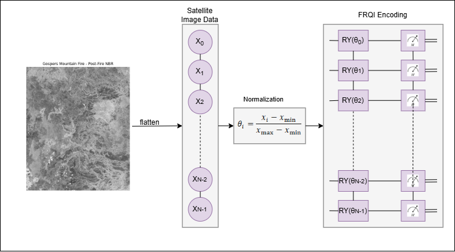

# Quantum Change Detection with FRQI Encoding (QCNN)

A quantum machine learning pipeline for **burned-area / change detection** from
bi-temporal satellite imagery (e.g. pre-fire and post-fire NBR bands), built with
[Qiskit](https://qiskit.org/) and a Quantum Convolutional Neural Network (QCNN)
architecture.

The pipeline extracts image patches, encodes each patch into a quantum state
using **FRQI (Flexible Representation of Quantum Images)**, trains a
parameterized quantum circuit (convolution + pooling layers) as a binary
classifier, and produces per-image burned-area prediction maps.

## Method Overview



Each pixel intensity `x_i` from the flattened, normalized image patch is mapped
to an angle `θ_i` and encoded onto a "color" qubit that is entangled with a
register of "position" qubits via multi-controlled `RY` rotations — this is the
FRQI encoding step shown above. The resulting quantum state is then processed by
alternating convolution and pooling layers before a final measurement yields the
change/no-change prediction.

## Pipeline

1. **Data loading** — reads co-registered pre-event (`B`) and post-event (`A`)
   raster bands (`.tif`/`.tiff`) plus ground-truth change masks for a training
   location and a held-out test location.
2. **Preprocessing** — percentile normalization (2–98%) of the `A` (post-event)
   and `B` (pre-event) bands.
3. **Patch extraction** — sliding-window patches are cut from the normalized
   `A`/`B` bands and concatenated into a single feature vector per patch; patch
   labels come from the fraction of "burned" ground-truth pixels inside the
   patch.
4. **FRQI encoding** — each patch's feature vector is normalized to `[0, 1]`
   and encoded into a quantum state where pixel intensity becomes a rotation
   angle on a color qubit, entangled across a position-qubit register.
5. **QCNN classifier** — a stack of parameterized convolution blocks (`RY`,
   `RZ`, `CX`) and pooling blocks (`CRZ`, `CRY`) reduces the qubit register,
   trained end-to-end with the parameter-shift rule and an Adam optimizer.
6. **Prediction maps** — trained model probabilities are stitched back into
   full-resolution binary and probability raster maps for each image, saved as
   GeoTIFFs and PNG comparison figures (`B` pre-image / `A` post-image / ground
   truth / prediction).

## Repository Structure

```
.
├── qcnn_change_detection.py   # main pipeline (data loading, FRQI encoding, QCNN, prediction maps)
├── docs/
│   └── method_overview.png    # FRQI encoding diagram
├── loc/                       # training location data (see "Data Layout")
│   ├── A/                     # post-event band
│   ├── B/                     # pre-event band
│   └── ground_truth/
├── india_loc/                 # test location data
│   ├── A_india/                # post-event band
│   ├── B_india/                # pre-event band
│   └── ground_truth_india/
└── outputs/                   # generated prediction maps (created at runtime)
    ├── loc_train/
    └── india_test/
```

## Data Layout

Each location provides two raster band folders, `A` (post-event) and `B`
(pre-event), which are percentile-normalized and used directly as model input
as well as for visualization, plus a `ground_truth` folder holding the binary
change mask. Files across the three folders for a given location must be
sorted so that entry *i* in each folder corresponds to the same scene.

## Requirements

- Python 3.9+
- `numpy`
- `rasterio`
- `matplotlib`
- `scikit-learn`
- `qiskit`
- `qiskit-aer`

Install with:

```bash
pip install numpy rasterio matplotlib scikit-learn qiskit qiskit-aer
```

## Usage

Place your data under `loc/` and `india_loc/` following the structure above,
then run:

```bash
python qcnn_change_detection.py
```

Outputs (prediction maps as PNG comparison figures and GeoTIFF rasters, plus
the trained circuit parameters) are written to `outputs/`.

## Configuration

Key parameters live in the `CONFIG` dictionary at the top of
`qcnn_change_detection.py`, including:

- `patch_size`, `stride`, `map_stride` — patch geometry for training vs. the
  full prediction map
- `n_qubits` — number of FRQI position qubits (circuit uses `n_qubits + 1`
  qubits total, including the color qubit)
- `epochs`, `batch_size`, `lr`, `beta1`, `beta2` — training hyperparameters
- `shots` — number of circuit shots per evaluation
- `max_train_patches`, `max_test_patches` — size of the balanced training/test
  patch pool

## License

This project is licensed under the [MIT License](LICENSE).
